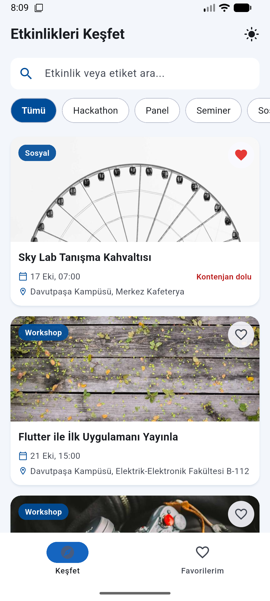
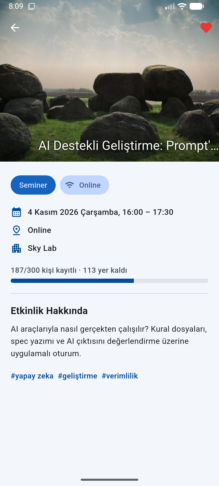
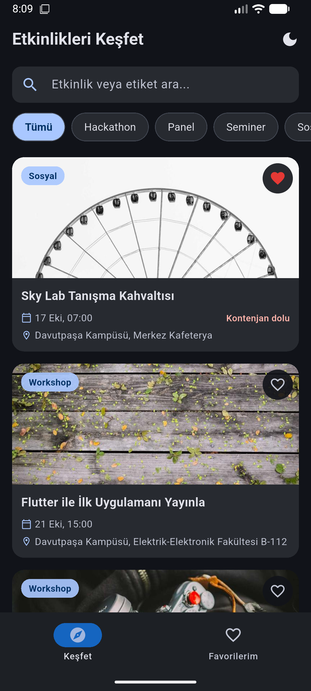

# Etkinlik Keşif


MOBILAB görevi için geliştirilmiş, [MOBILAB Task API](https://mobilab-task-api.vercel.app/docs)'den etkinlikleri çeken bir Flutter uygulaması.

<p>
  
  
  
</p>

## Özellikler

**Zorunlu**
- Etkinlik listesi ve detay ekranı (detayda açıklama, kontenjan, organizatör, etiketler)
- Arama (başlık ve etiketlerde) ve kategoriye göre filtreleme
- Favoriler: cihazda saklanır, uygulama kapanınca kaybolmaz, internet yokken de görünür
- Yükleniyor, hata (Tekrar Dene butonuyla) ve boş liste durumları

**Bonus**
- Sonsuz kaydırma ile sayfalama (+ gerekirse "Daha fazla yükle" butonu)
- Açık / koyu / sistem teması, seçim kalıcı olarak saklanır
- Animasyonlar: karttan detaya Hero geçişi, favori kalbinin zıplaması, yeni yüklenen kartların sırayla belirmesi, kontenjan çubuğunun dolması, durumlar arası yumuşak geçiş
- GitHub Actions ile CI: her push'ta `flutter analyze` ve `flutter test`

## Çalıştırma

Gereksinim: Flutter (stable kanal, Dart 3.13+).

```bash
git clone https://github.com/altinsoybetul/etkinlik-kesif.git
cd etkinlik-kesif
flutter pub get
flutter run
```

Testleri çalıştırmak için:

```bash
flutter test
```

Testler internete çıkmaz; sahte bir API (`test/fake_api_service.dart`) kullanır.

## Klasör yapısı

```
lib/
├── main.dart                 # Uygulama girişi, Provider'lar ve tema bağlantısı
├── models/
│   └── event_model.dart      # EventModel ve sayfa yanıtı (EventPage)
├── services/
│   ├── api_service.dart      # HTTP istekleri, hata mesajları, tekrar deneme
│   └── storage_service.dart  # shared_preferences: favoriler ve tema
├── providers/
│   ├── event_provider.dart   # Liste, sayfalama, filtre ve favori durumu
│   └── theme_provider.dart   # Açık / koyu / sistem tema seçimi
├── screens/
│   ├── main_navigation_screen.dart  # Alt menü (Keşfet / Favorilerim)
│   ├── home/                 # Liste, arama, kategori çipleri
│   ├── detail/               # Etkinlik detayı
│   └── favorites/            # Favoriler
├── widgets/                  # Birden fazla ekranda kullanılan parçalar
├── theme/
│   └── app_theme.dart        # Renkler ve bileşen stilleri (mavi tema)
└── utils/
    └── date_formatter.dart   # ISO tarihleri Türkçe ve okunabilir yapar
test/                         # Birim ve widget testleri
.github/workflows/ci.yml      # CI
```

**Neden böyle?** Katmanlar tek yönlü konuşuyor: ekranlar sadece Provider'ı bilir, Provider servisleri kullanır, servisler de dış dünyayla (API, cihaz hafızası) konuşur. Böylece:
- API değişirse sadece `api_service.dart` değişir, ekranlara dokunmak gerekmez.
- Provider'a sahte bir API verip interneti olmadan test edebiliyorum.
- Ekranlar kendi klasöründe, ortak widget'lar `widgets/` altında; bir dosyanın nerede olduğunu tahmin etmek kolay.

State management için **Provider** seçtim: Flutter ekibinin önerdiği, öğrenmesi kolay ve bu büyüklükte bir uygulama için yeterli.

## Önemli kararlar

- **Arama ve filtre sunucuda yapılıyor.** API sayfalı (varsayılan 10 kayıt) olduğu için sadece yüklenmiş sayfada filtrelemek eksik sonuç verirdi. Bu yüzden `q` ve `category` parametreleri API'ye gönderiliyor.
- **Arama için debounce.** Her harfte istek atmamak için kullanıcı yazmayı 400 ms bırakınca istek gidiyor.
- **Eski isteklerin sonucu yok sayılıyor.** Hızlı yazınca eski bir aramanın cevabı yenisinin üstüne yazmasın diye her isteğe bir numara veriliyor; güncel olmayan cevap çöpe gidiyor.
- **Favoriler tam veriyle saklanıyor.** Sadece id saklasaydım, henüz yüklenmemiş sayfadaki bir favori Favorilerim ekranında görünmezdi. Etkinliğin kendisini JSON olarak saklıyorum; internet yokken de favoriler açılıyor.
- **Detay ayrı istekle geliyor.** Liste yanıtında `description` yok, bu yüzden detay ekranı listedeki veriyle hemen açılıyor ve açıklamayı `/events/{id}`'den arka planda çekiyor.
- **Hatalara dayanıklılık.** API bilerek ara sıra yavaş ve hatalı (500) dönüyor. Sunucu hatası ve zaman aşımında bir kez sessizce tekrar deneniyor; yine olmazsa kullanıcıya anlaşılır bir mesaj ve "Tekrar Dene" butonu gösteriliyor. Sonraki sayfa hata verirse yüklenmiş liste kaybolmuyor, sadece listenin altında tekrar dene çıkıyor.
- **Renkler tek yerden.** Ekranlarda sabit renk yok; hepsi `Theme.of(context).colorScheme`'den geliyor. Ana renk `app_theme.dart`'taki tek bir mavi (`seed`); koyu tema da buradan otomatik üretiliyor.

## AI'yı nasıl kullandım

**Araçlar**
- **Gemini (tarayıcıda):** Projenin ilk halini kurarken kullandım. Klasör yapısını, modeli,servisleri ve ekranları ana hatlarıyla onunla oluşturdum. Ancak verdiği kod birçok hata çıkardı ve bunları düzeltmek zamanımın büyük kısmını aldı.
- **Claude:** Uygulama çalışır hale geldikten sonra kullandım. İlk bakışta fark edilmeyen hataları bulmak, bonus kısımları (sayfalama, açık/koyu tema, animasyonlar, CI) eklemek ve README'yi düzenlemek için. CI'ın ne olduğunu da hiç bilmiyordum, onu da bu süreçte öğrendim.

**Kurallarım**
- **Hatayı sadece düzelttirmedim, nedenini anlamaya çalıştım.** Hata aldığımda mesajı Gemini'ye yapıştırıp neden olduğunu sordum; düzeltmeyi uygulamadan önce sebebini anlamaya çalıştım.
- **Kodu yapıştırmadan önce okudum.** Anlamadığım yerlerde satır satır açıklamasını istedim.
- **Tasarım kararlarını kendim verdim.** AI'ın önerdiği arayüzü ve renkleri beğenmediğim yerlerde değiştirdim; son halinde mavi ağırlıklı bir tema istedim.

**Örnek promptlar**
- *"Bu Flutter uygulaması Android'de internetten veri çekiyor. Çalışması için kod dışında eklenmesi gereken bir izin ya da ayar var mı?"*
- *"API'nin dokümantasyonu bu: https://mobilab-task-api.vercel.app/docs. Benim `api_service.dart` kodum bu API'yi doğru kullanıyor mu? Kaçırdığım parametre, alan ya da sayfalama var mı?"*
- *"Uygulamam API'den gelen verilerin hepsini gösteriyor mu? Nasıl kontrol edebilirim?"*
- *"Az önce yazdığın kodu eleştirel gözle tekrar incele. Gözden kaçmış hata, uç durum ya da çökme ihtimali var mı? Sadece 'her şey doğru' deme, en zayıf noktasını söyle."*
- *"Bu kod internet yokken, API hata verdiğinde ya da boş liste döndüğünde ne yapar? Her durumu ayrı ayrı anlat."*

**AI'nın yanıldığı / benim düzelttiğim yerler**
- **İnternet izni eksikti.** Gemini'nin ilk verdiği kodla uygulama hiç veri çekmiyor, sadece "etkinlik bulunamadı" diyordu. Araştırınca Android'de internete çıkmak için `AndroidManifest.xml` dosyasına `INTERNET` izninin eklenmesi gerektiğini öğrendim. İzni ekledikten sonra veriler gelmeye başladı.
- **Uygulama etkinliklerin hepsini göstermiyordu ve bunu ben fark etmemiştim.** API varsayılan olarak sayfa başına 10 kayıt döndürüyor, toplamda ise 16 etkinlik var. İlk sürüm sadece ilk sayfayı çektiği için 6 etkinlik hiç görünmüyordu. Ayrıca liste yanıtında açıklama alanı olmadığı için detay ekranında gerçek açıklama hiç çıkmıyordu. Bunu Claude, API dokümantasyonunu
inceleyerek buldu; ben de emülatörde 16 etkinliğin ve açıklamaların geldiğini kontrol ederek doğruladım. Bu bana, uygulamanın çalışıyor görünmesinin doğru çalıştığı anlamına gelmediğini gösterdi.
- **Otomatik düzeltmeler de yanılabiliyor.** VS Code'un önerdiği bir refactor, satırın yarısını değiştirdi: `?` işaretini ekledi ama `if` kontrolünü silmedi. Sonuçta yeni bir uyarı çıktı. Satırın neden hatalı olduğunu anlayıp düzelttim.
- **Aynı dosyada AI ile birlikte çalışırken dikkat etmek gerekiyor.** Claude bir dosyayı düzelttikten sonra, dosya VS Code'da açık olduğu için eski hali kaydedildi ve düzeltme kayboldu. O satırı sonunda kendim düzelttim.